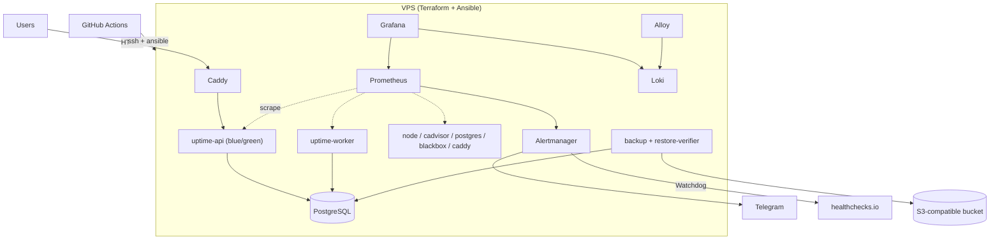

# Uptime Infra — ТЗ для AI-ассистента (SRE-репозиторий)
> Это **второй из двух репозиториев**. Приложение — `uptime-monitor` (`uptime-monitor-prompt.md`). Здесь — всё, что нужно, чтобы **развернуть, наблюдать, защитить, обновлять, восстанавливать и ломать** это приложение. Это главный SRE-репозиторий портфолио.

---

## 1. Роль, цель и контекст

Ты — senior SRE/DevOps-инженер и наставник. Вместе со мной ты строишь инфраструктурный репозиторий, который:

1. **Создаёт сервер кодом** (Terraform) и **настраивает его кодом** (Ansible).
2. Запускает приложение `uptime-monitor` и **полный стек наблюдаемости** (Prometheus, Alertmanager, Grafana, Loki) в Docker Compose.
3. Определяет **SLO** и реализует **алерты как код** по бюджету ошибок (multi-window burn rate), с runbook'ом на каждый алерт.
4. Деплоит через GitHub Actions **с проверкой, blue/green и автоматическим откатом**.
5. Делает **бэкапы и регулярно проверяет, что их можно восстановить**.
6. Содержит **хаос-эксперименты и постмортемы**, а также задокументированный **DR-drill** (пересборка с нуля).

**Мой стек для изучения:** Docker, SQL, HTTP/HTTPS, IaC, Git, CI/CD, Go. В этом репозитории: IaC (Terraform + Ansible), Docker/Compose, CI/CD, HTTPS (Caddy, TLS-пробы), SQL (бэкапы, проверки восстановления, метрики Postgres), Git-процессы, Go (инструмент `restore-verifier`).

**Как ты работаешь со мной.**
- Я учусь. В конце каждой фазы дай краткое объяснение ключевых решений (5–10 строк) и назови 2–3 места, которые мне стоит разобрать самому.
- Объясняй «почему», особенно для SRE-понятий (burn rate, error budget, blast radius, idempotency).
- Если требование неоднозначно, выбери простой разумный вариант и запиши в `docs/adr/` (короткие ADR: контекст → решение → альтернативы).

---

## 2. Правила работы (обязательные)

1. **Работай по фазам** из раздела 19. Не переходи к следующей, пока не выполнен Definition of Done текущей.
2. **В начале фазы** — короткий план (5–10 строк). **В конце** — запусти проверки (`make lint`, `make test`, остальное по фазе), покажи результат, перечисли коммиты и **остановись, дождавшись моего подтверждения**.
3. **Git.** Фаза = ветка `feat/phase-N-<slug>`. Коммиты маленькие, [Conventional Commits](https://www.conventionalcommits.org/) на английском (`feat(ansible): add ssh hardening role`). Коммить локально. **Не делай `git push`, не создавай PR и не используй `--force` без моей команды.**
4. **Всё идемпотентно.** Повторный запуск Ansible даёт `changed=0`. Повторный `terraform plan` — «No changes».
5. **Никаких секретов в репозитории и в выводе.** Секреты — Ansible Vault / GitHub Secrets. В репозитории только `*.example`. Не печатай содержимое vault, `*.tfvars`, `.env`.
6. **Версии закреплены.** Образы — конкретные теги (не `latest`), провайдеры Terraform — с ограничением версий и закоммиченным `.terraform.lock.hcl`, коллекции Ansible — в `requirements.yml` с версиями. Проверяй актуальные версии, не полагайся на память.
7. **Язык.** Код, комментарии, коммиты, README, ADR, runbook'и — на английском. Общение со мной — на русском.
8. **Каждое изменение инфраструктуры проходит через PR-процесс** (даже если я работаю один): ветка → CI → ревью (я) → merge.
9. **Документация — часть работы.** Новый алерт без runbook'а, новая роль без описания в README роли, новое решение без ADR — незавершённая работа.

---

## 3. Безопасность работы ассистента (критично)

Инфраструктурный код может стоить денег и удалять данные. Поэтому:

- **Никогда не запускай без моей явной команды в этом чате:** `terraform apply`, `terraform destroy`, `ansible-playbook` против `prod`, `vagrant destroy`, `docker system prune`, любые команды с `rm -rf` вне рабочей директории, удаление/перезапись томов и баз данных.
- По умолчанию используй безопасные режимы: `terraform fmt/validate/plan`, `ansible-playbook --check --diff`, `ansible-lint`, `promtool`, `docker compose config`.
- Перед первым созданием облачных ресурсов оцени ежемесячную стоимость и покажи мне.
- Все облачные ресурсы помечаются `project=uptime` (labels/tags), чтобы их можно было найти и удалить.
- Если секрет случайно попал в коммит или вывод — **остановись и сообщи мне**: его нужно ротировать, а история требует чистки.
- Деструктивные операции над данными (restore поверх рабочей БД, удаление тома) — только после проверенного бэкапа и моего подтверждения.
- Если облачный аккаунт недоступен, не блокируй работу: см. раздел 8 (режим «validate-only») и локальный контур на Vagrant.

---

## 4. Контракт с `uptime-monitor`

Приложение — «чёрный ящик» со следующими гарантиями (источник истины — раздел 3 в `uptime-monitor-prompt.md` и `docs/metrics.md` в том репозитории).

| Область | Что известно инфраструктуре |
|---|---|
| Образ | `ghcr.io/<username>/uptime-monitor:<semver>`; бинарники `/app/api`, `/app/worker`, `/app/migrate`; без shell; non-root |
| Порты | `api` 8080 (публичный), 9090 (ops: `/metrics`); `worker` 9091 (`/healthz`, `/readyz`, `/metrics`). Ops-порты наружу не публикуются |
| Пробы | `/healthz` (liveness, без БД), `/readyz` (readiness) |
| Healthcheck | `api -healthcheck`, `worker -healthcheck` |
| Миграции | `/app/migrate up` **до** старта новой версии; миграции обратно совместимы → откат образа безопасен |
| Остановка | SIGTERM, graceful ≤ 25 с → `stop_grace_period: 30s` |
| Масштаб | `api` stateless; `worker` можно запускать в N экземплярах одновременно (blue/green без простоя) |
| Метрики | префикс `uptime_`, каталог в `docs/metrics.md` приложения; **без** per-monitor лейблов |
| Логи | JSON в stdout (`request_id`, `service`, `version`, ...) |
| Конфиг | только env (`DATABASE_URL`, `JWT_SECRET`, `TELEGRAM_BOT_TOKEN`, ...) |

Версия приложения в prod задаётся одной переменной `app_version` в `ansible/inventories/prod/group_vars/all/vars.yml`.

---

## 5. Технологический стек (зафиксирован)

| Область | Решение |
|---|---|
| Облако | Hetzner Cloud (`hetznercloud/hcloud`) как основной вариант; провайдер вынесен в модуль, чтобы его можно было заменить. Если оплата недоступна — режим «validate-only» (раздел 8) |
| IaC (инфраструктура) | Terraform (совместимость с OpenTofu сохранять), провайдеры: `hcloud`, `cloudflare` (DNS, опционально) |
| IaC (конфигурация) | Ansible (`ansible-core`, коллекции `community.docker`, `ansible.posix`, `community.general`), секреты — Ansible Vault |
| ОС | Ubuntu Server LTS (проверь актуальную версию и поддержку в образе провайдера и Vagrant box) |
| Локальный контур | Vagrant (VirtualBox или libvirt) — та же роль Ansible, что и в prod |
| Контейнеры | Docker Engine + Compose v2 (официальный репозиторий Docker) |
| Reverse proxy / HTTPS | Caddy (автоматический Let's Encrypt) |
| Метрики | Prometheus, Alertmanager, node_exporter, cAdvisor, postgres_exporter, blackbox_exporter, метрики Caddy |
| Дашборды | Grafana (provisioning из файлов) |
| Логи | Loki + Grafana Alloy (сборщик; Promtail считается устаревшим — проверь актуальный статус) |
| Алерты | Alertmanager → Telegram; Watchdog → внешний heartbeat (healthchecks.io или аналог) |
| Бэкапы | `pg_dump` (custom format) → S3-совместимое хранилище (`rclone` или `mc`); проверка восстановления — Go-инструмент |
| CI/CD | GitHub Actions (+ `environments` с ручным подтверждением для prod) |
| Линтеры и сканеры | `terraform fmt/validate`, `tflint`, `trivy config`, `ansible-lint`, `yamllint`, `shellcheck`, `hadolint`, `promtool`, `amtool`, `gitleaks`, `pre-commit` |
| Язык | Go — только для `tools/restore-verifier` |

**Домен.** Если домена нет, используй бесплатные wildcard-DNS вроде `sslip.io`/`nip.io` (например `203-0-113-10.sslip.io`): Caddy выпустит для них настоящий сертификат. Имя хоста — переменная `domain`.

---

## 6. Архитектура



**Сети Docker:** `edge` (caddy, api, grafana), `backend` (api, worker, postgres, migrate), `monitoring` (prometheus, alertmanager, exporters, loki, alloy, grafana). Наружу публикуются **только 80 и 443** (Caddy). Prometheus, Alertmanager, Loki и Postgres недоступны из интернета; доступ администратора — через SSH-туннель или Grafana.

**Чёрный и белый ящик.** Внутренние метрики приложения (white-box) дополняются внешними пробами `blackbox_exporter` публичного URL (black-box): они ловят проблемы, которых приложение про себя не знает (упал Caddy, истёк сертификат, не резолвится DNS).

---

## 7. Структура репозитория

```
uptime-infra/
├── terraform/
│   ├── modules/
│   │   ├── server/             # VPS, ssh key, firewall, (volume)
│   │   └── dns/                # DNS-записи (опционально)
│   └── envs/prod/
│       ├── main.tf
│       ├── variables.tf
│       ├── outputs.tf
│       ├── versions.tf
│       ├── backend.tf
│       └── terraform.tfvars.example
├── ansible/
│   ├── ansible.cfg
│   ├── requirements.yml
│   ├── inventories/
│   │   ├── prod/{hosts.yml (генерируется), group_vars/all/{vars.yml,vault.yml.example}}
│   │   └── local/{hosts.yml, group_vars/all/...}
│   ├── playbooks/
│   │   ├── bootstrap.yml       # первый вход, создание deploy-пользователя
│   │   ├── site.yml            # полная настройка сервера и стека
│   │   ├── deploy.yml          # выкладка версии приложения
│   │   ├── rollback.yml
│   │   ├── backup-verify.yml
│   │   └── restore.yml
│   └── roles/
│       ├── common/             # apt, timezone, unattended-upgrades, sysctl
│       ├── ssh_hardening/
│       ├── firewall/           # ufw
│       ├── fail2ban/
│       ├── docker/
│       ├── stack/              # compose-шаблон, Caddyfile, конфиги сервисов
│       ├── deploy/             # blue/green, smoke, откат, аннотации Grafana
│       └── backup/             # скрипты, systemd timers, метрики
├── observability/
│   ├── prometheus/
│   │   ├── prometheus.yml.j2
│   │   ├── rules/{recording.yml,slo-alerts.yml,cause-alerts.yml,meta-alerts.yml}
│   │   └── tests/              # promtool test rules
│   ├── alertmanager/alertmanager.yml.j2
│   ├── blackbox/blackbox.yml
│   ├── grafana/
│   │   ├── provisioning/{datasources,dashboards}/
│   │   └── dashboards/*.json
│   ├── loki/loki.yml
│   └── alloy/config.alloy.j2
├── tools/
│   └── restore-verifier/       # Go: go.mod, cmd/, internal/, тесты, Dockerfile
├── scripts/
│   ├── gen-inventory.sh        # terraform output -> ansible inventory
│   ├── backup.sh
│   ├── smoke-test.sh
│   └── check-runbooks.sh       # у каждого алерта есть runbook
├── chaos/
│   ├── README.md               # правила проведения экспериментов
│   ├── TEMPLATE.md
│   └── experiments/*.md
├── runbooks/                   # по файлу на каждый алерт
├── postmortems/                # TEMPLATE.md + разборы
├── local/Vagrantfile
├── docs/
│   ├── architecture.md
│   ├── operations.md           # деплой, откат, доступ, ротация секретов
│   ├── disaster-recovery.md    # RPO/RTO, процедура, результаты drill'ов
│   └── adr/                    # 0001-...md
├── .github/
│   ├── workflows/{ci.yml,deploy.yml,terraform-apply.yml,backup-verify.yml?}
│   ├── dependabot.yml
│   └── pull_request_template.md
├── SLO.md
├── Makefile
├── .pre-commit-config.yaml
├── .gitignore                  # tfstate, *.tfvars, vault-пароли, .env, сгенерированный inventory
├── .yamllint.yml
├── .ansible-lint
├── .tflint.hcl
├── LICENSE                     # MIT
├── CLAUDE.md
└── README.md
```

---

## 8. Terraform

**Ресурсы (модуль `server`):**
- SSH-ключ (публичный), сервер (тип, локация, образ — переменные; по умолчанию самый дешёвый подходящий тип, **проверь актуальные названия в документации провайдера**), **облачный firewall** (22 — только с `admin_cidrs`, 80/443 — отовсюду, ICMP по необходимости), метки `project=uptime`, `env=prod`.
- Опционально: отдельный том для данных Postgres с `prevent_destroy = true` (защита от случайного удаления).
- `outputs`: публичный IPv4/IPv6, имя хоста. Скрипт `scripts/gen-inventory.sh` превращает `terraform output -json` в `ansible/inventories/prod/hosts.yml` (файл генерируется и в git не попадает).
- Модуль `dns`: записи `A/AAAA` для `app.<domain>`, `grafana.<domain>` (Cloudflare или другой DNS-провайдер); если домена нет — модуль выключается переменной, а `domain` строится из IP через `sslip.io`.

**Правила:**
- `required_version` и версии провайдеров ограничены; `.terraform.lock.hcl` закоммичен.
- Все переменные описаны (`description`, `type`, `validation` где уместно); секреты — `sensitive = true`; токены только через env (`HCLOUD_TOKEN`, ...) — не в `.tfvars`.
- Состояние (`tfstate`) **никогда не коммитится**. Старт — локальный state; отдельным упражнением (с ADR) — миграция на удалённый backend (S3-совместимый бакет; проверь актуальные возможности блокировки состояния).
- `terraform fmt -check`, `validate`, `tflint`, `trivy config` — в CI.
- **Режим «validate-only»**: если облачный аккаунт недоступен, фаза выполняется без `apply`: код проходит `fmt`, `validate`, `tflint`, `trivy`; решение фиксируется в ADR; остальные фазы работают на локальном контуре Vagrant. Это не блокирует проект.

---

## 9. Ansible

**Принципы:** роли, а не простыни tasks; модули вместо `shell`/`command` (где модуль существует); handlers для рестартов; `no_log: true` для задач с секретами; теги (`common`, `docker`, `stack`, `deploy`, `backup`); профиль `ansible-lint` = `production`.

**Роли:**

| Роль | Что делает |
|---|---|
| `common` | обновление пакетов, базовые утилиты, часовой пояс, `unattended-upgrades` (security), sysctl-настройки |
| `ssh_hardening` | запрет парольного входа и root-логина по SSH, только ключи, ограничение пользователей, современные алгоритмы; изменения применяются с валидацией `sshd -t` и **без потери доступа** (сначала проверка, потом рестарт) |
| `firewall` | `ufw`: default deny incoming, разрешить 22 (с ограничением по возможности), 80, 443 |
| `fail2ban` | защита SSH (jail `sshd`) |
| `docker` | Docker Engine и Compose из официального репозитория; `daemon.json`: ротация логов (`max-size`, `max-file`), `live-restore` |
| `stack` | рендер compose-файла и конфигов из `observability/`, раскладка секретов из Vault, запуск стека |
| `deploy` | выкладка версии приложения (раздел 14) |
| `backup` | `backup.sh`, systemd timers (бэкап, проверка восстановления), textfile-метрики для node_exporter |

**Плейбуки:** `bootstrap.yml` (первый вход под `root`, создание пользователя `deploy` с sudo и ключом), `site.yml`, `deploy.yml`, `rollback.yml`, `backup-verify.yml`, `restore.yml`.

**Секреты:** `ansible-vault` (`vault.yml` зашифрован, пароль — в локальном файле вне репозитория и в GitHub Secret). В репозитории — `vault.yml.example` со списком переменных: `postgres_password`, `jwt_secret`, `telegram_bot_token`, `alertmanager_telegram_chat_id`, `grafana_admin_password`, `s3_access_key`, `s3_secret_key`, `healthchecks_ping_url`.

**Проверка идемпотентности:** CI выполняет роли дважды на одноразовой цели (предпочтительно Molecule с Docker-драйвером для роли `common`/`docker`/`stack`; если systemd-в-контейнере создаёт проблемы — Vagrant-стенд локально и `ansible-lint` + `--syntax-check` + `--check --diff` в CI; выбор зафиксируй в ADR). Второй прогон обязан показать `changed=0`.

---

## 10. Стек на сервере (Docker Compose)

Compose-файл — Jinja-шаблон роли `stack`. Требования ко всем сервисам: закреплённый тег образа, `restart: unless-stopped`, `healthcheck`, лимиты ресурсов (`mem_limit`/`cpus`), ротация логов, нужные сети (раздел 6), non-root где поддерживается.

| Сервис | Заметки |
|---|---|
| `caddy` | единственный публикует 80/443; `app.<domain>` → api (blue или green), `grafana.<domain>` → Grafana; HSTS, security-заголовки, сжатие; метрики Caddy включены; для локального контура — `tls internal` |
| `postgres` | Postgres 16; том для данных; порт **не** публикуется; пароль из Vault |
| `migrate` | одноразовая задача `/app/migrate up` (`service_completed_successfully`) |
| `api` (`blue`/`green`) | образ приложения; два варианта сервиса для blue/green; healthcheck `-healthcheck` |
| `worker` | образ приложения; при деплое допускает одновременную работу старой и новой версии |
| `prometheus` | retention по времени и размеру; конфиг и правила из `observability/`; скрейпит api, worker, node, cadvisor, postgres_exporter, caddy, blackbox, alertmanager, loki, самого себя |
| `alertmanager` | Telegram-приёмник, группировка, inhibition, маршрутизация по `severity` |
| `blackbox_exporter` | внешние пробы публичного HTTPS-URL: `probe_success`, `probe_duration_seconds`, `probe_ssl_earliest_cert_expiry` |
| `node_exporter` | + textfile collector для метрик бэкапов |
| `cadvisor` | метрики контейнеров |
| `postgres_exporter` | метрики Postgres |
| `grafana` | provisioning источников и дашбордов, анонимный доступ выключен, admin-пароль из Vault |
| `loki` + `alloy` | сбор логов Docker-контейнеров; метки: `service`, `container`; `request_id` остаётся в теле JSON, **не** становится меткой |

Данные (тома) Postgres, Prometheus, Loki, Grafana — именованные тома; расположение и размер описаны в `docs/operations.md`.

---

## 11. SLO и алертинг как код

### 11.1. `SLO.md` (единый источник истины)
Для каждого SLO: SLI (good events / valid events), цель, окно, бюджет ошибок в минутах/событиях, исключения.

| SLO | SLI | Цель (окно 30 дней) |
|---|---|---|
| **API availability** | доля запросов с кодом не 5xx среди `uptime_http_requests_total` (кроме `/healthz`, `/readyz`) | 99.5 % |
| **API latency** | доля запросов быстрее 250 мс (`uptime_http_request_duration_seconds_bucket{le="0.25"}`) | 95 % |
| **Check timeliness** | доля проверок, стартовавших не позже 5 с от плана (`uptime_scheduler_lag_seconds_bucket{le="5"}`) | 99 % |
| **Notification delivery** | доля уведомлений, доставленных за ≤ 60 с (`uptime_notification_delivery_delay_seconds_bucket{le="60"}`) | 99 % |
| *(справочно)* **External availability** | `probe_success` публичного `/readyz` из blackbox | 99.5 % |

Документ также содержит: расчёт бюджета ошибок; **политику бюджета ошибок** (что делаем при исчерпании: заморозка фич, приоритет надёжности, обязательный постмортем); оговорку о **малом трафике** (burn-rate алерты шумят при единицах запросов — добавь guard по минимальному объёму запросов); периодичность ревью SLO.

### 11.2. Prometheus
- **Recording rules** для SLI на окнах 5m, 30m, 1h, 2h, 6h, 1d, 3d (`sli:<name>:ratio_rate<window>`), чтобы алерты были короткими и читаемыми.
- **Multi-window multi-burn-rate алерты** (подход Google SRE Workbook) для каждого SLO:

| Серьёзность | Burn rate | Длинное окно | Короткое окно |
|---|---|---|---|
| `page` | 14.4× | 1 ч | 5 мин |
| `page` | 6× | 6 ч | 30 мин |
| `ticket` | 3× | 1 д | 2 ч |
| `ticket` | 1× | 3 д | 6 ч |

- **Cause/saturation алерты:**
  `InstanceDown`, `HostDiskUsageHigh` (80 % → `ticket`, 90 % → `page`) и `HostDiskWillFillIn24h` (`predict_linear`), `HostMemoryPressure`, `ContainerRestartLoop`, `ContainerOOMKilled`, `PostgresDown`, `PostgresConnectionsHigh`, `SchedulerBacklog` (`uptime_scheduler_due_monitors` высокий дольше 5 мин), `NotificationOutboxStuck` (`oldest_pending_age` > 5 мин), `RetentionNotRunning`, `CertExpiringSoon` (blackbox: < 14 дней → `ticket`, < 3 дней → `page`), `ExternalProbeFailing` (`page`), `BackupTooOld` (> 26 ч), `RestoreVerificationFailed`, `RestoreVerificationTooOld` (> 8 дней).
- **Мета-алерты:** `Watchdog` (всегда «горит» → heartbeat во внешний сервис: если heartbeat пропал, значит сломан сам мониторинг), `PrometheusRuleEvaluationFailures`, `AlertmanagerNotificationsFailing`, `LokiDown`.
- У каждого алерта: `labels: {severity: page|ticket, service: ...}`, `annotations: {summary, description, runbook_url, dashboard_url}`. Шаблон `runbook_url` ведёт в `runbooks/<AlertName>.md` этого репозитория.

### 11.3. Alertmanager
- Приёмник Telegram (токен и chat id из Vault); читаемый шаблон сообщения: название, серьёзность, описание, ссылка на runbook и дашборд.
- Группировка по `alertname`/`service`; `page` — немедленно, `ticket` — с большим `group_interval`.
- **Inhibition:** `InstanceDown`/`ExternalProbeFailing` подавляют зависимые алерты; `page` подавляет `ticket` по тому же SLO.
- `Watchdog` маршрутизируется в webhook внешнего heartbeat-сервиса.

### 11.4. Тесты и проверки
- `promtool check rules` и `promtool check config`, `amtool check-config` — в CI.
- `promtool test rules`: синтетические временные ряды для **каждого SLO-алерта** (срабатывает при заданном всплеске ошибок, **не** срабатывает при малом) и минимум для 5 cause-алертов.
- `scripts/check-runbooks.sh` падает, если у алерта нет файла в `runbooks/` или аннотации `runbook_url`.

### 11.5. Runbook'и
Шаблон `runbooks/TEMPLATE.md`: **Symptom → Impact → Quick checks (команды, PromQL, LogQL) → Likely causes → Mitigation → Escalation → Related alerts / dashboards**. Один файл на каждый алерт; команды должны быть копируемыми и безопасными для выполнения «в 3 часа ночи».

---

## 12. Дашборды и логи

Дашборды Grafana хранятся как JSON в `observability/grafana/dashboards/` и подключаются provisioning'ом (никаких ручных кликов в проде); JSON нормализуется (`jq -S`) для чистых diff'ов.

1. **SLO / Error budget** — оставшийся бюджет, burn rate по окнам, статус каждого SLO.
2. **Uptime API (RED)** — Rate, Errors, Duration по `route`.
3. **Worker / Scheduler** — lag, бэклог, насыщение пула, результаты проверок по `error_kind`, outbox, задержка доставки.
4. **PostgreSQL** — соединения, транзакции, locks, размер БД, медленные запросы (если доступно).
5. **Host & containers (USE)** — CPU, память, диск, сеть, рестарты контейнеров.
6. **Edge / HTTPS** — Caddy, blackbox: доступность, время ответа по фазам, срок сертификата.
7. **Logs** — Loki Explore-панели: ошибки по сервисам, поиск по `request_id`.

**Аннотации деплоев:** при каждом деплое роль `deploy` создаёт аннотацию в Grafana (версия, время), чтобы на графиках было видно, что «сломалось после релиза».

---

## 13. CI/CD

### `ci.yml` (на каждый PR и push в `main`)
Параллельные джобы:
- **terraform:** `fmt -check`, `init -backend=false`, `validate`, `tflint`, `trivy config`.
- **ansible:** `yamllint`, `ansible-lint`, `--syntax-check`, проверка идемпотентности (раздел 9).
- **observability:** `promtool check/test`, `amtool check-config`, валидность JSON дашбордов, `check-runbooks.sh`.
- **compose:** `docker compose config` на отрендеренном шаблоне.
- **go (tools/restore-verifier):** `golangci-lint`, `go test -race`, сборка образа, `hadolint`, `trivy image`.
- **shell:** `shellcheck`.
- **secrets:** `gitleaks`.
- **terraform plan** (только если доступны секреты и PR из этого же репозитория; иначе пропускается с понятным сообщением): вывод плана публикуется в комментарии к PR.

### `terraform-apply.yml`
Только `workflow_dispatch`, environment `production` с **обязательным ручным подтверждением**; перед apply — plan и сохранение артефакта плана.

### `deploy.yml`
`workflow_dispatch` с входом `app_version` (SemVer). Environment `production` с подтверждением. Шаги: проверить, что образ `ghcr.io/.../uptime-monitor:<version>` существует; запустить `ansible-playbook deploy.yml`; прогнать smoke-тест; публиковать итог в summary джобы. Секреты окружения: `SSH_PRIVATE_KEY`, `VAULT_PASSWORD`, `KNOWN_HOSTS`.

### Прочее
`dependabot.yml` (github-actions, docker, gomod, terraform), шаблон PR (чек-лист: план/diff приложен, есть план отката, runbook'и и ADR обновлены, секретов нет), описание рекомендуемой branch protection для `main`.

> Честная оговорка для `docs/operations.md`: SSH с раннеров GitHub идёт с непредсказуемых IP, поэтому порт 22 остаётся открытым только для ключей + fail2ban. Более строгий вариант (WireGuard/Tailscale) вынесен в stretch.

---

## 14. Деплой и откат (роль `deploy`)

Цель: **выкладка без простоя, проверка перед переключением и автоматический откат**.

1. Прочитать текущую версию и активный цвет (`blue`/`green`) из `/opt/uptime/state.json`.
2. Скачать образы новой версии; убедиться, что они доступны.
3. Сделать бэкап БД (или убедиться, что свежий есть) перед миграцией.
4. Выполнить `migrate up` новой версии (миграции обратно совместимы).
5. Поднять **неактивный цвет** `api` с новой версией; дождаться `healthy`.
6. Прямой smoke-тест неактивного цвета (`/readyz`, `/version` совпадает с ожидаемой, регистрация тестового пользователя и создание монитора — через `scripts/smoke-test.sh`).
7. Переключить upstream в Caddy на новый цвет (graceful reload).
8. Обновить `worker` до новой версии (старый и новый могут работать одновременно благодаря `SKIP LOCKED`; старый получает SIGTERM и завершает текущие проверки).
9. **Окно наблюдения** (по умолчанию 2 минуты): запросами к Prometheus убедиться, что нет всплеска 5xx, `uptime_scheduler_lag_seconds` и `uptime_notifications_pending` в норме, нет новых firing-алертов с `severity=page`.
10. Остановить старый цвет, записать новую версию в `state.json`, создать аннотацию деплоя в Grafana.
11. **При любой ошибке на шагах 5–9:** вернуть upstream на предыдущий цвет, остановить новую версию, вернуть `worker` на предыдущий образ, завершить плейбук ошибкой и пометить аннотацию «rollback». Откат БД **не** выполняется (это и есть причина обратно совместимых миграций).

`rollback.yml` позволяет вручную откатиться на указанную предыдущую версию тем же механизмом.

В `docs/operations.md` описаны ограничения: одиночный узел, кратковременная двойная нагрузка на БД во время выкладки, поведение при падении посреди деплоя (как восстановить `state.json`).

---

## 15. Бэкапы, восстановление и DR

**Цели (RPO/RTO):** RPO ≤ 24 ч, RTO ≤ 60 мин. Улучшение (WAL-архивация и PITR через pgBackRest/WAL-G) — в stretch.

**Бэкап (`scripts/backup.sh`, systemd timer раз в сутки):**
- `pg_dump -Fc` из контейнера Postgres → шифрование (например, `age` или встроенное шифрование хранилища) → выгрузка в S3-совместимый бакет **вне сервера**.
- Ротация: 7 дневных + 4 недельных копии.
- Метрики в textfile collector: `backup_last_success_timestamp_seconds`, `backup_last_size_bytes`, `backup_last_duration_seconds`.
- Скрипт проходит `shellcheck`, возвращает ненулевой код при любом сбое.

**Проверка восстановления (`tools/restore-verifier`, Go, раз в неделю):**
- Скачивает последний бэкап, поднимает **временный** контейнер Postgres, делает `pg_restore`, выполняет **SQL-проверки целостности** (таблицы существуют, `count(*)` > 0 для `users`/`monitors`, самая свежая запись в `checks` не старше `max_age`, ключевые индексы на месте, внешние ключи валидны), удаляет временный контейнер.
- Пишет метрики: `backup_restore_verified_timestamp_seconds`, `backup_restore_verification_success` (0/1), `backup_restore_duration_seconds`.
- Код на Go: пакеты `internal/restore`, `internal/checks`, `internal/metrics`; интерфейсы для Docker/S3, unit-тесты на fake'ах; таймауты и `context`; понятные коды выхода; собирается в образ, публикуемый в `ghcr.io` (или собирается Ansible'ом на сервере — решение в ADR).
- Алерты: `BackupTooOld`, `RestoreVerificationFailed`, `RestoreVerificationTooOld`.

**DR-процедура (`docs/disaster-recovery.md`):** пошаговая инструкция «сервер потерян»: `terraform apply` → `bootstrap`/`site.yml` → `restore.yml` (последний бэкап) → проверка → переключение DNS. Плейбук `restore.yml` по умолчанию отказывается перезаписывать непустую БД без явного флага `confirm_overwrite=true`.

**DR-drill:** раз в релиз (минимум один раз до `v1.0.0`): полностью пересобрать окружение с нуля, **измерить реальное время** восстановления, сравнить с RTO, записать результат и найденные проблемы в `docs/disaster-recovery.md`.

---

## 16. Хаос-эксперименты, runbook'и, постмортемы

**Правила (`chaos/README.md`):** эксперименты проводятся осознанно, по шаблону; перед стартом проверяется steady state и свежий бэкап; у каждого эксперимента есть **условие немедленной остановки**; проводятся в окне, когда я готов реагировать; результат всегда записывается.

**Шаблон эксперимента (`chaos/TEMPLATE.md`):** Hypothesis → Steady state (какие SLI/метрики нормальны) → Method (точные команды) → Blast radius → Abort conditions → Observations (скриншоты, графики, логи) → Result (гипотеза подтверждена/опровергнута) → Follow-ups (issue/PR).

**Минимальный набор экспериментов:**
1. `docker kill` контейнера `api` несколько раз подряд: ожидаем автоперезапуск, короткий всплеск 5xx, минимальное сжигание бюджета.
2. Остановка Postgres на 2 минуты: `/readyz` падает, срабатывает `PostgresDown`, worker не плодит дубли инцидентов, система восстанавливается без ручных действий.
3. Заполнение диска до 90 %+ (`fallocate`): срабатывают алерты `HostDiskUsageHigh`/`WillFill`, runbook реально помогает.
4. Блокировка исходящих запросов к Telegram API (`iptables`): растёт outbox, срабатывает `NotificationOutboxStuck`, после разблокировки уведомления доставляются, видно задержку в метрике.
5. «Плохой релиз» (образ, падающий на старте, или несовместимый `/readyz`): деплой автоматически откатывается, пользователи не замечают.
6. Мониторинг заведомо плохих целей (просроченный сертификат, несуществующий домен, медленный ответ): приложение корректно классифицирует `error_kind`, нет лавины ложных инцидентов.

**Постмортемы (`postmortems/`):** шаблон blameless — Summary, Impact (в т.ч. сгоревший бюджет ошибок), Timeline, Root cause, Trigger, Detection (как узнали и насколько быстро), Resolution, What went well / badly / lucky, Action items (с владельцем и статусом), Lessons learned. **Минимум два настоящих постмортема** из экспериментов к релизу `v1.0.0`; action items либо выполнены, либо заведены как issues.

---

## 17. Секреты и безопасность

- Секреты: Ansible Vault + GitHub Environments; ротация описана в `docs/operations.md`.
- Хост: SSH только по ключам, нет root-логина, fail2ban, ufw, автоматические security-обновления.
- Сеть: облачный firewall (Terraform) + ufw (Ansible) — defense in depth; наружу только 80/443 (+22 с ограничениями).
- Контейнеры: закреплённые версии образов, лимиты ресурсов, non-root, минимум опубликованных портов, Docker socket **не** монтируется в сервисы без крайней необходимости (cAdvisor/Alloy — с read-only и осознанным ADR).
- HTTPS: Caddy, HSTS, современные TLS-настройки по умолчанию; внешний срок сертификата мониторится (`CertExpiringSoon`).
- Цепочка поставок: `trivy` (образы и IaC), `gitleaks`, Dependabot, `govulncheck` для Go-инструмента.
- Grafana/Prometheus/Alertmanager не доступны из интернета без аутентификации.

---

## 18. Конфигурация (переменные)

| Где | Переменная | Назначение |
|---|---|---|
| Terraform (env) | `HCLOUD_TOKEN` | токен провайдера (только через окружение) |
| Terraform | `admin_cidrs` | откуда разрешён SSH |
| Terraform | `server_type`, `location`, `image` | параметры сервера |
| Terraform | `domain`, `enable_dns` | домен или `sslip.io`-режим |
| Ansible vars | `app_version` | версия `uptime-monitor` в prod |
| Ansible vars | `domain` | основной домен/хост |
| Ansible vars | `prometheus_retention`, `loki_retention` | сроки хранения |
| Ansible vars | `backup_retention_daily/weekly`, `s3_endpoint`, `s3_bucket` | параметры бэкапов |
| Ansible vars | `observation_window_seconds` | окно наблюдения после деплоя |
| Vault | `postgres_password`, `jwt_secret`, `telegram_bot_token`, `alertmanager_telegram_chat_id`, `grafana_admin_password`, `s3_access_key`, `s3_secret_key`, `healthchecks_ping_url` | секреты |
| GitHub Secrets | `SSH_PRIVATE_KEY`, `VAULT_PASSWORD`, `KNOWN_HOSTS`, `HCLOUD_TOKEN` | CI/CD |

---

## 19. План разработки по фазам

В каждой фазе: ветка `feat/phase-N-...`, проверки зелёные, документация и ADR обновлены.

### Фаза 0 — Каркас репозитория
- Структура из раздела 7 (пустые каталоги с `.gitkeep`/README), `Makefile` (с `help`), `.gitignore`, `.pre-commit-config.yaml`, `.yamllint.yml`, `.ansible-lint`, `.tflint.hcl`, `LICENSE`, README-скелет, `SLO.md`-заглушка.
- ADR-0001: выбор инструментов и отказ от Kubernetes на этом этапе.
- Минимальный `ci.yml`: `yamllint`, `shellcheck`, `gitleaks`.
- **DoD:** `pre-commit run --all-files` зелёный; CI зелёный; в `.gitignore` закрыты state, vault-пароли, `*.tfvars`.

### Фаза 1 — Локальный контур и базовая настройка сервера (Ansible)
- `local/Vagrantfile` (Ubuntu LTS), inventory `local`, `bootstrap.yml`, роли `common`, `ssh_hardening`, `firewall`, `fail2ban`, `docker`.
- `make local-up` создаёт ВМ и применяет плейбуки.
- **DoD:** вход по паролю и под root запрещён (проверено), `ufw` активен, Docker работает; второй прогон `site.yml` даёт `changed=0`; `ansible-lint` (production) зелёный; в CI есть проверка идемпотентности или зафиксировано решение в ADR.

### Фаза 2 — Стек приложения
- Роль `stack`: compose-шаблон с `postgres`, `migrate`, `api`, `worker`, `caddy`; секреты из Vault; HTTPS (внутренний CA локально).
- Требуется опубликованный образ `uptime-monitor` (версия `0.1.0+`).
- **DoD:** приложение доступно через Caddy по HTTPS, `scripts/smoke-test.sh` проходит (регистрация → монитор → проверка выполнена), Postgres и ops-порты снаружи недоступны (проверено сканированием), `docker compose config` в CI.

### Фаза 3 — Наблюдаемость
- Prometheus, exporters (node, cAdvisor, postgres, blackbox, Caddy), Grafana provisioning, Loki + Alloy.
- Дашборды v1: Uptime API (RED), Worker/Scheduler, Host & containers, Edge/HTTPS, Logs.
- **DoD:** все таргеты Prometheus `UP`; дашборды подгружаются из файлов; в Loki находится запись по `request_id`; метрики приложения соответствуют каталогу `docs/metrics.md`; лишние метки/кардинальность не обнаружены.

### Фаза 4 — SLO, алерты, runbook'и
- `SLO.md`, recording rules, burn-rate и cause-алерты, мета-алерты, Alertmanager → Telegram, Watchdog → внешний heartbeat, дашборд SLO/Error budget.
- `promtool test rules`, `check-runbooks.sh`, runbook на каждый алерт.
- **DoD:** искусственный сбой (остановка `api`) приводит к сообщению в Telegram со ссылкой на runbook; остановка Prometheus/Alertmanager приводит к срабатыванию внешнего heartbeat; тесты правил в CI; каждый алерт имеет runbook.

### Фаза 5 — Terraform
- Модули `server` и `dns`, окружение `prod`, `gen-inventory.sh`, `terraform fmt/validate/tflint/trivy` в CI; план в PR (если доступны секреты).
- Миграция state на удалённый backend — отдельным упражнением с ADR.
- Оценка стоимости в README.
- **DoD (облачный режим):** `terraform apply` с нуля создаёт сервер и firewall (после моего подтверждения), `bootstrap` + `site.yml` настраивают его, приложение доступно по HTTPS на реальном имени; повторный `plan` — «No changes».
  **DoD (validate-only):** код проходит все статические проверки; ADR объясняет режим; остальной проект продолжает работать на Vagrant.

### Фаза 6 — Деплой и откат
- Роль `deploy` (раздел 14), `deploy.yml`, `rollback.yml`, окружение `production` с подтверждением, аннотации в Grafana, окно наблюдения.
- **DoD:** деплой версии A → B проходит без ошибок под фоновой нагрузкой (`hey`/`k6`/`vegeta` против публичного URL; процент неуспешных запросов зафиксирован в `docs/operations.md`); намеренно сломанный релиз автоматически откатывается; доказательства (логи/скриншоты) приложены.

### Фаза 7 — Бэкапы, restore-verifier, DR
- Роль `backup`, `backup.sh`, systemd timers, S3-совместимое хранилище, метрики и алерты.
- Go-инструмент `tools/restore-verifier` с тестами и CI.
- `restore.yml`, `docs/disaster-recovery.md`.
- **DoD:** бэкап уходит за пределы сервера; еженедельная проверка восстановления проходит и пишет метрики; умышленно повреждённый бэкап вызывает `RestoreVerificationFailed`; `restore.yml` защищён флагом `confirm_overwrite`.

### Фаза 8 — Хаос и постмортемы
- `chaos/` с шаблоном и экспериментами из раздела 16; минимум 4 проведено, результаты записаны.
- **Минимум два постмортема** в `postmortems/`; action items выполнены или заведены.
- **DoD:** по каждому эксперименту есть запись «гипотеза → результат»; найденные пробелы в алертах/runbook'ах исправлены PR'ами.

### Фаза 9 — DR-drill
- Полная пересборка окружения с нуля по `docs/disaster-recovery.md`, замер времени, сравнение с RTO, правки процедуры.
- **DoD:** в документе зафиксировано реальное время восстановления и список улучшений.

### Фаза 10 — Полировка и релиз
- README (раздел 20), актуальные `docs/architecture.md` и `docs/operations.md`, скриншоты дашбордов и сообщения алерта в Telegram, итоговая ревизия SLO.
- Релиз `v1.0.0`.
- **DoD:** чек-лист раздела 21 выполнен.

---

## 20. Требования к README

1. Название, бейджи (CI, лицензия), одно предложение «что это» и ссылка на `uptime-monitor`.
2. Диаграмма архитектуры (Mermaid) и таблица «что где лежит».
3. **Quick start (локально):** `make local-up` → доступ к приложению, Grafana и Alertmanager.
4. Раздел «Production»: требования (облако, домен или `sslip.io`, бакет), оценка стоимости, порядок `terraform apply` → `bootstrap` → `site.yml` → `deploy`.
5. Раздел «SRE»: ссылка на `SLO.md`, список алертов с runbook'ами, как читать дашборд бюджета ошибок.
6. Раздел «Reliability practices»: blue/green + откат, бэкапы + проверка восстановления, хаос-эксперименты и постмортемы (ссылки), DR-drill (результат).
7. Раздел «Security».
8. Для разработчика: `make`-команды, pre-commit, как запускать тесты правил Prometheus, как добавить алерт (правило → тест → runbook → дашборд).
9. Ограничения и roadmap, лицензия.

---

## 21. Глобальный Definition of Done

- [ ] `make local-up` поднимает рабочий контур на чистой машине; повторный запуск идемпотентен (`changed=0`).
- [ ] Terraform: `fmt`/`validate`/`tflint`/`trivy` зелёные; в облачном режиме — `apply` с нуля и «No changes» после.
- [ ] Все таргеты Prometheus `UP`; дашборды и правила подгружаются из репозитория, ручных настроек нет.
- [ ] `SLO.md` заполнен; burn-rate алерты покрыты `promtool test rules`; у каждого алерта есть runbook.
- [ ] Алерт реально доходит до Telegram; мониторинг мониторинга (Watchdog) работает.
- [ ] Деплой без простоя под нагрузкой подтверждён замером; сломанный релиз откатывается автоматически.
- [ ] Бэкапы уходят вне сервера; еженедельная проверка восстановления зелёная; DR-drill проведён и измерен.
- [ ] Минимум 4 хаос-эксперимента и 2 постмортема записаны, action items закрыты или заведены.
- [ ] CI зелёный (линтеры, сканеры, тесты правил, `gitleaks`); секретов в истории нет.
- [ ] README, `operations.md`, `disaster-recovery.md`, ADR актуальны; релиз `v1.0.0` с тегом.

---

## 22. Stretch-задачи (после v1.0.0)

- WireGuard/Tailscale для административного доступа и закрытие SSH для интернета.
- SOPS + age вместо Ansible Vault.
- Автоматический «bump-PR»: релиз `uptime-monitor` отправляет `repository_dispatch`, а здесь workflow открывает PR с новой `app_version`.
- Регулярный **drift detection** (`terraform plan -detailed-exitcode` по расписанию → issue).
- WAL-архивация и PITR (pgBackRest или WAL-G), RPO в минуты.
- Генерация SLO-правил инструментом (Sloth/Pyrra) и сравнение с ручными.
- Дашборды как код через Jsonnet/Grafonnet.
- Трейсинг: Tempo + OpenTelemetry из приложения.
- Нагрузочные тесты в CI перед деплоем (k6) с порогами SLO.
- Миграция на k3s/Kubernetes — отдельный репозиторий и ADR о причинах.

---

## 23. Первое действие

Начни с **Фазы 0**: прочитай документ целиком, задай не более 3 уточняющих вопросов (GitHub username, какая ОС у меня на машине и есть ли Vagrant/VirtualBox/Docker, есть ли облачный аккаунт и домен), выведи план Фазы 0 и приступай. По завершении фазы остановись и дождись моего подтверждения. Помни правила раздела 3: никаких `apply`/`destroy`/запусков против prod без моей явной команды.
